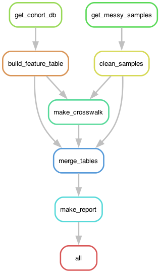

# Lab 5: Scalable Analysis Workflow

A Snakemake pipeline that chains my Lab 3 cleaning script and my Lab 4 SQL into one workflow: clean `messy_samples.csv`, query `cohort.db`, merge the two, and write a summary report.



The two branches don't depend on each other until they meet at `make_crosswalk`. That's what makes the partial rerun work: changing the messy CSV doesn't touch the SQL side.

## Setup

```bash
conda env create -f environment.yml
conda activate lab5
snakemake --version    # 9.x
```

The environment has Snakemake 9, pandas, matplotlib, and graphviz (for drawing the DAG).

## Clean run (from nothing)

Run from the repo root:

```bash
snakemake --delete-all-output     # deletes every file the workflow made, including data/raw/
snakemake --cores 2               # 8 jobs
snakemake -n                      # should say "Nothing to be done"
```

Raw data isn't committed. The first two rules download `messy_samples.csv` and `cohort.db` from the course repo (URLs are in `config.yaml`), so a clean run only needs internet.

## Partial rerun

Change one value in the raw samples file (S0001's glucose, 145.9 -> 95.0), then dry run:

```bash
# macOS
sed -i '' 's/^S0001,\(.*\),145.9,/S0001,\1,95.0,/' data/raw/messy_samples.csv
# Linux
sed -i 's/^S0001,\(.*\),145.9,/S0001,\1,95.0,/' data/raw/messy_samples.csv

snakemake -n          # 5 jobs: clean_samples, make_crosswalk, merge_tables, make_report, all
snakemake --cores 2
```

`get_cohort_db` and `build_feature_table` don't rerun because nothing on their side changed.

To put the real data back afterwards:

```bash
snakemake --cores 2 -R get_messy_samples    # re-downloads the original and rebuilds downstream
```

## Evidence

All saved from my runs on my Mac (Snakemake 9.24.0):

| File | What it shows |
|---|---|
| `evidence/01_clean_run.txt` | Clean run after `--delete-all-output`. 8 of 8 jobs, and every `reason:` line says "Missing output files", so it really started empty |
| `evidence/02_nothing_to_do.txt` | Dry run right after: "Nothing to be done" |
| `evidence/03_edit_made.txt` | The edited S0001 line (glucose 95.0) |
| `evidence/04_partial_dryrun.txt` | Dry run after the edit: 5 jobs, no SQL-side jobs |
| `evidence/05_partial_rerun.txt` | The real rerun: 5 of 5. First reason is "Updated input files: data/raw/messy_samples.csv" |
| `evidence/rulegraph.png` | One box per rule |
| `evidence/dag.png` | Every job |

Something I didn't plan: I accidentally ran the partial-rerun block twice. The second time, `sed` had nothing to replace but still rewrote the file with a new timestamp, and Snakemake said "Nothing to be done". So it's checking whether the content actually changed, not just the timestamp (same as the `touch` example from lecture).

To redraw the DAG images:

```bash
snakemake --rulegraph | dot -Tpng > evidence/rulegraph.png
snakemake --dag | dot -Tpng > evidence/dag.png
```

## The pipeline

| Rule | Input | Output | What it does |
|---|---|---|---|
| `get_messy_samples` | `scripts/get_data.py` | `data/raw/messy_samples.csv` | downloads the Lab 3 raw file |
| `get_cohort_db` | `scripts/get_data.py` | `data/raw/cohort.db` | downloads the Lab 4 database |
| `clean_samples` | `scripts/clean_samples.py`, raw CSV | `results/samples_clean.csv` | my Lab 3 regex cleaner, unchanged |
| `build_feature_table` | `scripts/build_feature_table.py`, `cohort.db`, `sql/q1_gene_counts.sql`, `sql/q3_patient_features.sql` | `results/feature_table.tsv` | my Lab 4 SQL + pandas build, one row per patient |
| `make_crosswalk` | `scripts/make_crosswalk.py`, both tables above | `results/crosswalk.tsv` | fake sample-to-patient link (see below) |
| `merge_tables` | `scripts/merge_tables.py`, samples, crosswalk, features | `results/combined_table.tsv` | the merge, 60 rows x 21 columns |
| `make_report` | `scripts/make_report.py`, combined table | `results/report.md`, `results/summary_figure.png` | figure + text summary |

### No hidden dependencies

Every rule lists the script it runs as an input, plus any `.sql` file it reads. So if I edit `scripts/make_report.py`, Snakemake knows the report is out of date (tested while building this: 2 jobs rerun). The Week 10 demo Snakefile doesn't do this, so editing a script there reruns nothing.

The only settings (download URLs and the crosswalk seed) live in `config.yaml`, not hard-coded in the rules. Changing the seed with `--config crosswalk_seed=1` reruns 4 jobs (also tested while building).

Every rule also writes a log to `logs/` (not committed, it gets rebuilt every run).

### Changes from Labs 3 and 4

- `clean_samples.py` is my Lab 3 `clean_regex.py`, just renamed
- `build_feature_table.py` is my Lab 4 script with the hard-coded paths swapped for command-line arguments, so Snakemake can see every file it opens. Same logic and same asserts.
- `get_data.py` is my Lab 4 downloader, changed to take the URL as an argument so one script handles both files
- The course's `messy_samples.csv` was regenerated after Lab 3, so the values are different from my Lab 3 copy. My Lab 3 regex still parses all 60 rows.

## The crosswalk is fake

`messy_samples.csv` uses IDs like `S0001` and `cohort.db` uses TCGA barcodes. They don't share any ID, so there's no real way to join them. I couldn't find a mapping anywhere in the course repo.

So `make_crosswalk.py` makes one up: each sample gets a random TCGA patient of the same sex. The 18 samples with unknown sex get any patient, patients with no sex recorded are never used, and no patient is used twice. It's seeded (`crosswalk_seed: 6854`), so it comes out the same on every machine. S0001 got TCGA-62-8402 on my Mac and on the machine Claude tested on.

`merge_tables.py` checks that the merge keeps all 60 rows, that every join is one-to-one, and that every M/F sample landed on a male/female patient.

This is just so the merge step has something to join on. It's not real linkage, and nothing in the combined table should be read as an actual finding. The report says this at the top.

## Outputs

- `results/combined_table.tsv`: final combined table, one row per sample
- `results/report.md` + `results/summary_figure.png`: summary report
- `results/samples_clean.csv`, `results/feature_table.tsv`, `results/crosswalk.tsv`: intermediate tables

I committed these on purpose since the lab asks for the final table and report. They come from the unedited course data.

## Files

```
Snakefile             the workflow
config.yaml           download URLs + crosswalk seed
environment.yml       conda environment (lab5)
scripts/              one script per rule
sql/                  Lab 4 queries
results/              outputs (committed)
evidence/             run logs + DAG images
data/, logs/          made by the workflow, not committed
AI_USAGE.md           AI use log
```

## Comments for Instructor

- **The merge uses a made-up crosswalk.** The Lab 3 and Lab 4 data don't share an ID, so I linked samples to patients randomly by sex just to have something to merge on. It's seeded and documented above, and the report says it isn't real. If you meant for us to merge a different way, I'd like to know.
- **My Lab 3 regex runs on the current course CSV**, which is different from the version I had for Lab 3.
- **The `sed` command for the partial rerun is different on macOS and Linux** (`sed -i ''` vs `sed -i`). Both are listed above.
