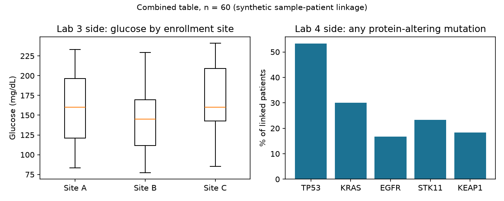

# Lab 5 summary report

Generated by `scripts/make_report.py` from `results/combined_table.tsv`. Rerun the pipeline and this file is rebuilt.

> **The sample-to-patient link is made up.** `messy_samples.csv` and `cohort.db` share no ID, so `scripts/make_crosswalk.py` pairs each sample with a random TCGA patient of the same sex. Nothing below that compares the two sides means anything biologically. This report describes the table, it doesn't make claims about patients.

## What's in the table

- **60 rows**, one per cleaned sample, each linked to one TCGA patient
- **21 columns**: Lab 3 fields (dob, sex, site, glucose + flags), the crosswalk, and Lab 4 features (age, stage, tissue source site, TMB, 5 gene counts)
- Samples per enrollment site: A = 23, B = 20, C = 17
- Sample sex: M = 22, F = 20, Unknown = 18 (Unknown-sex samples were linked to a patient of either sex)

## Lab 3 side

- Median glucose by site: A = 160.1 mg/dL, B = 144.9 mg/dL, C = 159.9 mg/dL
- 14 glucose values carry a flag. 13 were labeled mmol/L but the numbers only make sense as mg/dL, so they were kept as-is, not multiplied by 18.
- 15 dates of birth had 2-digit years and the century was inferred.

## Lab 4 side

- % of linked patients with any protein-altering mutation: TP53 53%, KRAS 30%, EGFR 17%, STK11 23%, KEAP1 18%
- 0 linked patients have no stage recorded in cohort.db.

## Missing values

- `dob_flag`: 45
- `glucose_flag`: 46
- `notes`: 56
- `age_at_diagnosis`: 1

`dob_flag`, `glucose_flag` and `notes` are mostly empty on purpose: blank means nothing needed flagging.
